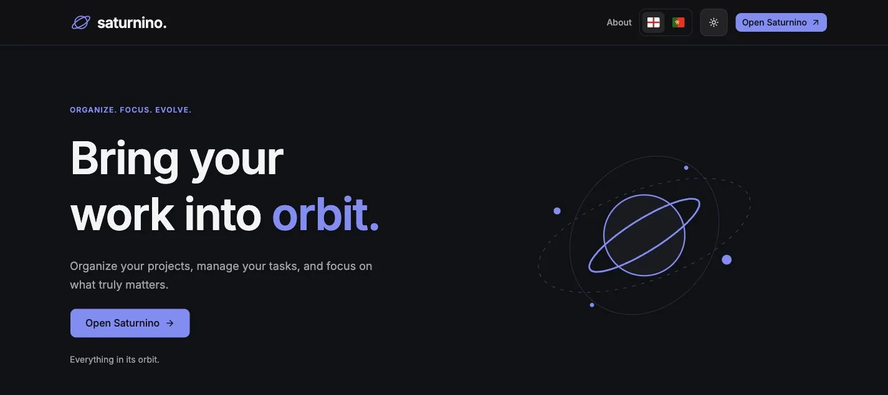
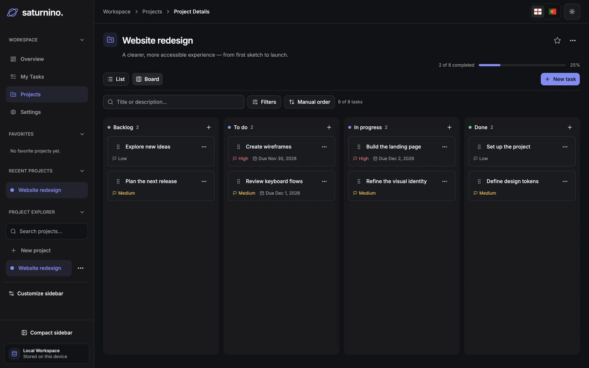
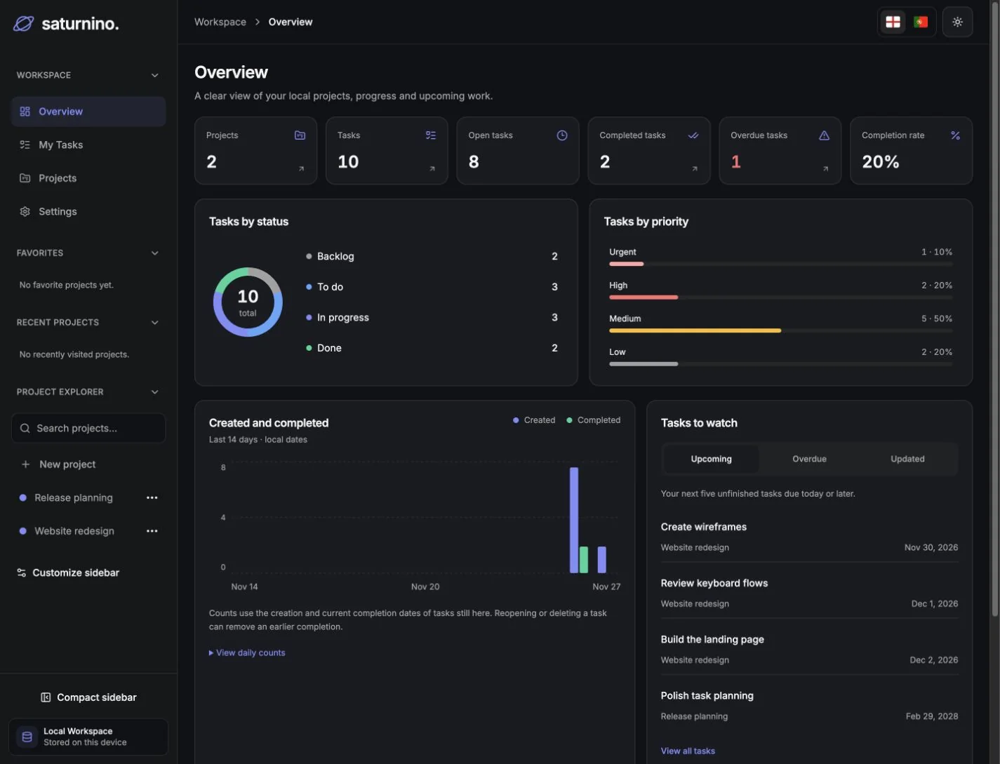
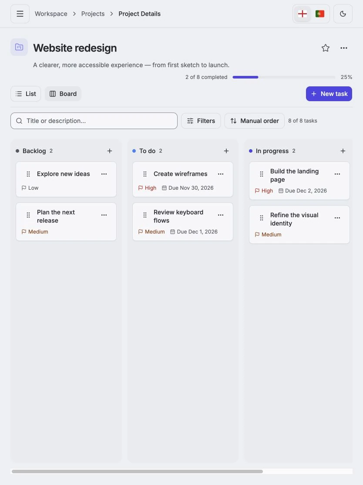
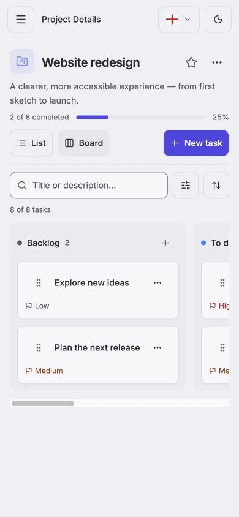

# Saturnino

> Everything in its orbit.

Saturnino is a local-first project and task manager for organizing work without an account. A focused Kanban workspace brings project progress, priorities and deadlines into one place, with a compact interface inspired by the application's orbital identity.

Built as a React frontend project, Saturnino combines practical task management with careful keyboard interactions, responsive layouts and data integrity. Work stays on your device, while English and Portuguese interfaces and light and dark themes make the workspace your own.

## Live Demo

[Open Saturnino](https://saturnino-app.vercel.app)

Explore the application in your browser or install it from your browser menu when supported. No sign-in, API keys or configuration are required.

## Preview

Real application screenshots using fictional project data.







| Tablet · Light mode                                                        | Mobile · Light mode                                                        |
| -------------------------------------------------------------------------- | -------------------------------------------------------------------------- |
|  |  |

## Features

- **Projects and tasks:** create, edit and organize work, track completion and keep favorite projects close through a customizable sidebar.
- **Kanban and list views:** drag cards by their title or surface, reorder work across four columns, or use keyboard handles and menus. Add tasks directly to a column.
- **Focused task details:** edit in a side panel on desktop or a full-screen panel on mobile, with explicit saving, unsaved-change protection and concurrent-edit detection.
- **Search and planning:** combine filters, choose a sort order and set deadlines with a localized calendar.
- **Dashboard and navigation:** explore status and priority distributions, retained-date activity and actionable deadlines. Return through your workspace with a Back control and personalize the sidebar and settings.
- **Backup and offline use:** export JSON backups or CSV, restore a validated workspace and use the cached application after a completed online visit.

Projects and tasks belong to the current browser profile and origin. There is no cloud synchronization; changing devices or clearing browser data can make records unavailable. Keep JSON backups, especially before moving your workspace or clearing storage.

## Motivation & Future Vision

Saturnino was born from a personal need to better organize my daily life, manage my projects, keep track of my tasks, and stay focused on what matters.

What started as a personal project has grown into an application designed for anyone looking for a simple, intuitive, and accessible way to organize their work and everyday life.

Saturnino currently follows a local-first approach, keeping projects and tasks stored directly on the user's device without requiring an account. It can also be installed as a Progressive Web App (PWA) on supported browsers and used offline after the initial setup.

The long-term vision is to introduce optional user accounts and cloud synchronization, allowing users to access and manage their workspace seamlessly across multiple devices while preserving the local-first experience.

Saturnino is an evolving project, built with purpose, simplicity, and continuous improvement in mind.

## Tech Stack

- **Interface:** React 19, JavaScript, Tailwind CSS 4, Radix UI and Lucide.
- **Navigation and forms:** React Router, React Hook Form, dnd-kit, DayPicker and i18next.
- **Local data and offline use:** Dexie / IndexedDB and Workbox.
- **Build and hosting:** Vite 8 and Vercel.

Quality checks use Vitest, React Testing Library, ESLint, Prettier and GitHub Actions. The application is hosted on Vercel.

## Getting Started

Use Node.js 26, the version used by CI, and npm.

```bash
git clone https://github.com/arafamdev/saturnino.git
cd saturnino
npm ci
npm run dev
```

Open the local URL printed by Vite. Run `npm test` for the test suite, `npm run lint` for linting and `npm run build` for a production build. Use `npm run preview` to preview that build, including offline caching.

## Author

**Arafam Mussa Silla**

[GitHub](https://github.com/arafamdev) · [LinkedIn](https://www.linkedin.com/in/arafam-mussa-silla-5a7866446/) · [Portfolio](https://arafam.dev)
